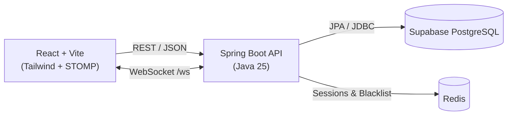

# MovieTime — Movie Ticket Booking System

A full-stack movie ticket booking application built with **Java 25 + Spring Boot** on the backend and **React + Vite + Tailwind CSS** on the frontend, backed by **Supabase PostgreSQL**, **Redis**, and **WebSockets (STOMP)** for real-time seat updates.

Repository: [github.com/hasrku/MovieTime-Ticket-Booking-System](https://github.com/hasrku/MovieTime-Ticket-Booking-System)

---

## Features

- **Role-Based Auth:** JWT access tokens (15 min) + opaque refresh tokens (30 days) stored in Redis & PostgreSQL (`admin` and `user` roles).
- **Unique Movie Slugs:** Clean movie URLs (`/movies/:slug`) with automatic conflict resolution.
- **Real-Time Seat Sync:** WebSocket (STOMP) broadcasts seat locks, unlocks, and bookings live to all viewers.
- **Simulated Checkout:** Seat selection, booking summary, simulated Pay button, and My Tickets view.
- **Reviews & Ratings:** Authenticated users can post movie reviews and 1–10 ratings.
- **Admin Dashboard:** Create/delete movies and schedule shows with custom seat grids.

---

## Architecture



---

## Setup Guide

### Prerequisites

- Java 25, Maven
- Node.js 18+
- Redis (optional — app degrades gracefully without it)
- Supabase PostgreSQL connection details

### 1. Clone the Repo

```bash
git clone https://github.com/hasrku/MovieTime-Ticket-Booking-System.git
cd MovieTime-Ticket-Booking-System
```

### 2. Start Redis (optional)

```bash
brew services start redis
```

### 3. Run the Backend (`http://localhost:8080`)

> Use the Supabase **Session Pooler** URL if your network does not support IPv6.

```bash
cd backend
export SUPABASE_DB_URL="jdbc:postgresql://<pooler-host>:5432/postgres?sslmode=require"
export SUPABASE_DB_USER="<your-supabase-user>"
export SUPABASE_DB_PASSWORD="<your-supabase-password>"
./mvnw spring-boot:run
```

### 4. Run the Frontend (`http://localhost:5173`)

```bash
cd frontend
npm install
npm run dev
```

---

## Demo Accounts (Seeded)

| Role  | Email                  | Password    |
|-------|------------------------|-------------|
| Admin | `admin1@movietime.com` | `Admin@123` |
| User  | `user1@movietime.com`  | `User@123`  |

---

## Documentation

- [Backend README](backend/README.md)
- [Frontend README](frontend/README.md)
